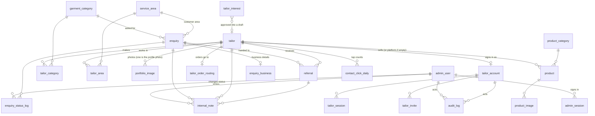

# Alfaiate TL — Data Model

Status: rewritten 2026-10-24 for the first deploy · Requirements: [PRD.md](PRD.md) · Architecture: [ARCHITECTURE.md](ARCHITECTURE.md)

The database is Cloudflare D1 (SQLite). The schema is **27 baseline migrations, one per table**, in `migrations/`, designed as one piece before anything was deployed (the earlier thirteen incremental files were thrown away; no data existed). **The migration files are the column-level source of truth**: every table and every non-obvious column carries a comment there. This document gives the map: what each file holds, how the tables relate, what is private, and the rules the database itself enforces.

## 1. Key distinctions

| Concept | Meaning | Where recorded |
|---|---|---|
| **Enquiry** | A customer's request submitted through a form. Not an appointment. | `enquiry` |
| **Referral** | Passing an enquiry to one tailor by hand, with the tailor's response. | `referral` |
| **Confirmed appointment** | Agreed between tailor and customer directly. **Not modelled** (BR-02/03). | — |
| **Reported completed order** | Someone *says* the order was completed; a date and a reporter on the referral. Not verified. | `referral.completion_*` |
| **Shop order** | A cart turned into a WhatsApp message. No customer data, no payment. | `shop_order` |

No measurement, garment, customer-account, payment or delivery tables exist (PRD §7.3).

## 2. The migration files

**One file per table**, named after the table (`0013_enquiry.sql`), in dependency order, each with a one-line header saying what the table is for and which requirement it serves. A table is defined in exactly one place with its final columns; no file exists to patch an earlier table. A file only references tables from earlier files, so there are no forward references. The conventions are stated in the header of `0001_admin_user.sql`.

| Area | Files (number order) |
|---|---|
| Staff sign-in | `0001_admin_user`, `0002_admin_session`, `0003_rate_limit` |
| Public catalogue | `0004_garment_category`, `0005_service_area`, `0006_tailor`, `0007_tailor_category`, `0008_tailor_area`, `0009_portfolio_image` |
| Tailor sign-in (portal) | `0010_tailor_account`, `0011_tailor_session`, `0012_tailor_invite` |
| Inbound and referral workflow (private) | `0013_enquiry`, `0014_enquiry_business`, `0015_enquiry_status_log`, `0016_referral` (with its four triggers), `0017_internal_note`, `0018_tailor_interest`, `0019_newsletter_signup` |
| Shop | `0020_product_category` (the only migration seed: four product types), `0021_product`, `0022_product_image`, `0023_tailor_order_routing`, `0024_shop_order` |
| Site records | `0025_audit_log`, `0026_contact_click_daily`, `0027_page_view_daily` |

Launch categories and areas are not migrations: `seeds/launch.sql` loads them once. Apply the migrations with `wrangler d1 migrations apply`.

## 3. How the tables relate

Standalone: `rate_limit`, `shop_order`, `newsletter_signup`, `page_view_daily`.

## 4. Conventions (stated in `0001_admin_user.sql`, enforced where it can be)

- Singular table names. A foreign key column is `<table>_id` (the historical short forms `category_id` and `area_id` on `tailor_category`, `tailor_area` and `product` are kept because they are also admin form field names; each is unambiguous inside its table).
- Timestamps are UTC ISO-8601 text in `*_at` columns with one default expression; calendar dates are text in `*_on` / `*_date` columns; booleans are `0/1` `is_*` columns (the legacy `permission_recorded`, `permission_granted`, `contact_publish_consent` are kept for the same reason as above). Enums are CHECK-constrained text.
- Phone numbers are `*_e164` columns with one shape (`+`, non-zero digit, digits only, 8 to 16 characters). The Timor-Leste rule (AD-10) is applied in code by `normalisePhone`.
- SQLite cannot share a CHECK, so the same expression is written out where needed; `tests/workers/schema-conventions.test.ts` fails if any copy differs, if a `*_at` column is not text, or if a timestamp default differs.
- Prices are whole minor units of one site-wide currency (US cents; OQ-14).
- Foreign keys are enforced. Staff are deactivated, never deleted. Lookup rows (categories, areas) are deactivated, never deleted while used.

## 5. What the database enforces

| Rule | Where |
|---|---|
| A tailor is published only when `approved` with permission recorded (BR-05, BR-06, AC-10) | CHECK on `tailor` |
| A tailor has at most one profile photo; no pointer on `tailor` | partial unique index `portfolio_image_one_profile_photo` |
| A referral needs an approved tailor and an enquiry that has sharing consent and live data (FR-REF-02, BR-08, AC-12) | four triggers on `referral` |
| Live enquiries have name, number and channel (PRV-01); anonymised ones have none of the personal columns (PRV-04) | two CHECKs on `enquiry` |
| `enquiry.source` is `form`, `business`, `shop` or `profile:<slug>` | CHECK |
| A fee exists only after a completion report; a completion names its reporter; `paid` needs a paid date | CHECKs on `referral` |
| A note belongs to exactly one of enquiry, tailor or referral | CHECK on `internal_note` |
| A join request is `pending` exactly while it has no decision time | CHECK on `tailor_interest` |
| An order route of `number` has a number, and the others do not | CHECK on `tailor_order_routing` |
| A product is published only with a description | CHECK on `product` |
| An audit row names at most one actor | CHECK on `audit_log` |
| A tailor account has an email and a password together or neither | CHECK on `tailor_account` |

Not enforced by the database (so enforced in code and tests): "at least one active owner" (one guarded UPDATE in `src/modules/auth/users.ts`), "a published tailor has a contact method", that `audit_log` is append-only (no code path updates it), and that a business enquiry has an `enquiry_business` row.

## 6. Public and private

| Public (only when published and permitted) | Private (admin only) |
|---|---|
| tailor profile fields, categories, areas, permitted photos, price notes with their source label, permitted products and their photos | everything in `0004_inbound.sql`; `tailor` columns under "admin only" (`private_contact_name`, `private_phone`, `fee_terms_*`); `referral`; notes; status log; staff and tailor accounts and sessions; `shop_order`; `tailor_order_routing`; `audit_log`; the counters |

`tailor.verified_fields` (JSON list of profile fields staff have checked) and `price_source` express what the owner verified; anything else shows as "information supplied by the tailor" (BR-11). No ratings, credentials or claims fields exist.

JSON in text is used in exactly three places, each justified: `tailor.verified_fields` (a short list edited as a whole), `shop_order.items_json` and `routes_json` (frozen snapshots of one prepared message, never filtered by field).

## 7. Anonymise and retention

- Customer data lives only in `enquiry`, `enquiry_business`, `tailor_interest` and `newsletter_signup`; `referral` stores no copy.
- **Anonymise an enquiry (FR-ADM-09):** one batch clears `customer_name`, `contact_number_e164`, `notes`, `service_description`, `area_text`, `preferred_datetime_text` and sets `anonymised_at`; **deletes the `enquiry_business` row**; clears `fields_shared_note`, `closed_reason`, `order_value_note` and `fee_basis_note` on its referrals; deletes its `internal_note` rows and the notes on its referrals; writes an `enquiry_anonymised` audit row (ids only). Category, area, status, status log, dates, source and fee amounts stay for reporting. Afterwards the code refuses free text on that enquiry.
- **Anonymise a join request:** clears name, business, phone, area, craft and message; keeps reference, consent and decision.
- Customer reference photos (FR-ENQ-07) are **not built and have no table**. If they ship, add a table and extend the anonymise routine to delete the rows and their private files.
- Retention period: OQ-09. Backups follow the same policy.

## 8. Delete behaviour

CASCADE: `admin_session`, `tailor_category`, `tailor_area`, `portfolio_image`, `tailor_account` and its sessions and invites, `tailor_order_routing`, `product_image`, a tailor's own `product`, `enquiry_business`, `enquiry_status_log`, `referral.enquiry_id`, `internal_note`, `contact_click_daily`. RESTRICT: `tailor_category.category_id`, `tailor_area.area_id`, `referral.tailor_id`, `internal_note.author_id`, `enquiry.garment_category_id`, `enquiry.area_id`. SET NULL: `audit_log` actors, `enquiry_status_log.changed_by`, `enquiry.preferred_tailor_id`, `tailor_interest.tailor_id`, `product.category_id`.

## 9. Indexes

`tailor(is_published, status)`, `tailor_category(category_id)`, `tailor_area(area_id)`, `portfolio_image(tailor_id, sort_order)` and the unique profile-photo index, `enquiry(status, created_at)`, `enquiry(garment_category_id)`, `enquiry(area_id)`, `enquiry(preferred_tailor_id)`, `enquiry_status_log(enquiry_id, changed_at)`, `referral(enquiry_id)`, `referral(tailor_id, fee_status)`, `internal_note` (one per owner column), `tailor_interest(created_at)`, `tailor_interest(tailor_id)`, `admin_session(admin_user_id)`, `tailor_session(tailor_account_id)`, `tailor_invite(tailor_account_id)`, `rate_limit(window_start)`, `audit_log(admin_user_id, id)`, `audit_log(tailor_account_id)`, `product(is_published, category_id)`, `product(seller_tailor_id)`, `product_image(product_id, sort_order)`, `shop_order(created_at)`; uniques on slugs, reference codes, token hashes, file keys and emails.

## 10. Requirement coverage

FR-PRO-* → `tailor`, `tailor_category`, `tailor_area`, `portfolio_image` · FR-ENQ-* → `enquiry`, `enquiry_business` (FR-ENQ-09) · FR-JOIN-* → `tailor_interest` · FR-TPO-* → `tailor_account`, `tailor_session`, `tailor_invite` · FR-SHP-* → `product*`, `tailor_order_routing`, `shop_order` · FR-PUB-08 → `newsletter_signup` · FR-ADM-* → the admin tables · FR-REF-* → `referral`, tailor fee terms · FR-RPT-* → computed from `enquiry`, `enquiry_status_log`, `referral` · SEC-05/BR-07 → the public/private split above · ANA-01 → `page_view_daily` · ANA-02 → `contact_click_daily`.

## 11. Changes from the first baseline (2026-10-24, before any deploy)

The design review that produced these files moved every "later addition" to its proper home. Old to new, for the columns that changed (all other columns kept their table and name; the complete 239-row list was checked by script with none missing):

| Old | New |
|---|---|
| `session` (table) | `admin_session` (pairs with `tailor_session`) |
| `audit_log.at` | `audit_log.created_at` |
| `contact_click_daily.date` | `contact_click_daily.day` (same name as `page_view_daily.day`; now CHECKed as a date) |
| `enquiry.organisation_name`, `enquiry.group_size_text` | `enquiry_business` (1:1; `organisation_name` is required there) |
| `tailor.order_route`, `tailor.order_number_e164` | `tailor_order_routing.route`, `.number_e164` (no row means the admin number) |
| `tailor.profile_photo_id` | `portfolio_image.is_profile_photo` with a partial unique index |
| `enquiry_attachment` (table) | dropped (feature not built) |
| `enquiry.source` (free text) | same column, now CHECK-constrained |

New constraints and indexes: see §5 and §9. Reasons and rejected alternatives are in [DECISIONS.md](DECISIONS.md) (2026-10-24).
